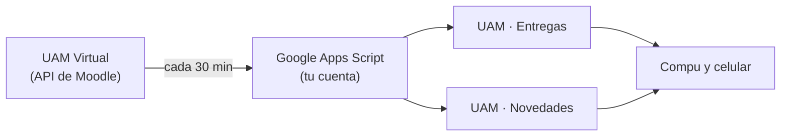

# UAM Virtual → Google Calendar

[](https://github.com/uxvcharlie/uamvirtual-calendario/actions/workflows/pruebas.yml)
[](LICENSE)
[](https://developers.google.com/apps-script)

Todo lo que publican tus profesores en [UAM Virtual](https://uamvirtual.uam.edu.ni/grado), en tu Google Calendar.

Sin instalar apps, sin servidores y gratis. Se instala en unos 5 minutos desde el navegador y sigue funcionando con la compu apagada.

```text
📝 AGBD: Tarea final — vence dom 8 nov, 23:00
📎 Redes II: Sesión 20 - VLAN
📢 Inglés: Second cut evaluations
⏰ Álgebra Lineal: Proyecto cambió a mar 10 nov, 23:59
```

> [!NOTE]
> Es un proyecto de estudiantes. No es un servicio oficial de la UAM ni está afiliado a ella.

## Qué hace

Crea dos calendarios en tu cuenta de Google:

| Calendario | Qué trae |
| --- | --- |
| **UAM · Entregas** | Cada tarea o cuestionario pendiente en su fecha límite, con recordatorios 1 día y 3 horas antes. |
| **UAM · Novedades** | Un evento que te avisa cuando se publica algo: tareas, presentaciones, archivos, enlaces y avisos del foro. |

Y se encarga de los detalles:

- **Cambios de fecha:** si el profesor mueve una entrega, mueve el evento y te avisa.
- **Tareas enviadas:** quedan marcadas con ✓ y dejan de recordarte.
- **Tus cambios se respetan:** lo que muevas o borres en el calendario no vuelve a su sitio.
- **Sin spam:** si suben 10 archivos a un curso, llega un solo aviso.
- **Sin avalancha al instalar:** lo que ya estaba publicado no te notifica.

## Instalación

Necesitas tu cuenta de Google y tu CIF y PIN de UAM Virtual. No hace falta saber programar.

### 1. Crea el proyecto

Abre <https://script.new> con la cuenta de Google donde quieres ver tu calendario. Arriba, cambia el nombre a `UAM Virtual Calendario`.

### 2. Pega el código

1. Abre [`uam-calendario.js`](https://raw.githubusercontent.com/uxvcharlie/uamvirtual-calendario/main/dist/uam-calendario.js) y copia todo con `Ctrl+A` y `Ctrl+C`.
2. Vuelve al editor, borra lo que hay en `Código.gs` y pega.
3. Guarda con `Ctrl+S`.

### 3. Activa Google Calendar

En el panel izquierdo, junto a **Servicios**, presiona **+**. Elige **Google Calendar API**, deja el identificador como `Calendar` y presiona **Agregar**.

### 4. Agrega tu CIF y tu PIN

Entra a ⚙️ **Configuración del proyecto**, baja a **Propiedades del script** y agrega estas dos:

| Propiedad | Valor |
| --- | --- |
| `UAM_CIF` | Tu CIF |
| `UAM_PIN` | Tu PIN |

Presiona **Guardar propiedades del script**.

### 5. Ejecuta `instalar`

Vuelve al **Editor**, elige la función `instalar` en la barra de arriba y presiona **Ejecutar**.

Google te pedirá permisos. Elige tu cuenta, entra a **Configuración avanzada**, luego a **Ir a UAM Virtual Calendario** y presiona **Permitir**. Ese aviso sale en todo script personal que Google no ha revisado. Si la ejecución se detiene después de aceptar, presiona **Ejecutar** otra vez.

Cuando diga **Ejecución completada**, ya está. `instalar` borra tu CIF y tu PIN de las propiedades.

### 6. Míralo en tu celular

Abre la app de Google Calendar y, en el menú, marca `UAM · Entregas` y `UAM · Novedades`.

## Preguntas frecuentes

<details>
<summary><strong>¿Es seguro poner mi PIN?</strong></summary>

Tu PIN solo está en tu propio proyecto de Google y solo durante la instalación. `instalar` lo cambia por un token de Moodle y lo borra, incluso si el login falla. Ni el autor ni nadie más reciben tus datos: no hay ningún servidor de por medio y puedes leer todo el código.

El token da acceso a tu cuenta de UAM Virtual. No compartas tu proyecto de Apps Script con nadie.
</details>

<details>
<summary><strong>¿Tengo que dejar la compu encendida?</strong></summary>

No. Corre en los servidores de Google, cada 30 minutos de 6:00 a 23:00.
</details>

<details>
<summary><strong>¿Cuánto cuesta?</strong></summary>

Nada. Usa la cuota gratuita de Google Apps Script.
</details>

<details>
<summary><strong>No me llegan los avisos en el celular</strong></summary>

1. En la app de Google Calendar, revisa que los dos calendarios estén marcados en el menú.
2. En los ajustes del teléfono, revisa que Google Calendar tenga permitidas las notificaciones.
3. Revisa que estés usando la misma cuenta de Google donde hiciste la instalación.
</details>

<details>
<summary><strong>Me salió el evento "renueva el token"</strong></summary>

Los tokens de Moodle vencen después de un tiempo. Repite los pasos 4 y 5: agrega `UAM_CIF` y `UAM_PIN`, y ejecuta `instalar`. No se duplica nada.
</details>

<details>
<summary><strong>¿Cómo actualizo a una versión nueva?</strong></summary>

Repite el paso 2. No hace falta volver a ejecutar `instalar`.
</details>

<details>
<summary><strong>¿Cómo lo desinstalo?</strong></summary>

1. En Apps Script, abre ⏰ **Activadores** y elimina el de `sincronizar`.
2. Elimina el proyecto desde <https://script.google.com/home>.
3. En Google Calendar, elimina `UAM · Entregas` y `UAM · Novedades`.
</details>

<details>
<summary><strong>¿Sirve para otra universidad?</strong></summary>

Sirve con cualquier Moodle que tenga activa la app móvil. Cambia `MOODLE_URL` y `ZONA` en la configuración, y `DESFASE_MANAGUA_` si tu zona horaria es distinta.
</details>

## Personalización

Los ajustes están al inicio del código, en `CONFIG`:

| Ajuste | Para qué sirve | Valor inicial |
| --- | --- | --- |
| `RECORDATORIOS_MINUTOS` | Minutos antes de cada entrega en que suena un recordatorio | `[1440, 180]` |
| `HORA_INICIO`, `HORA_FIN` | Horario en que revisa, para no avisarte de madrugada | `6` a `23` |
| `MINUTOS_ENTRE_REVISIONES` | Cada cuánto revisa: 1, 5, 10, 15 o 30 | `30` |
| `NOMBRES_CURSOS` | Nombres cortos por código de materia | 6 materias |

Si cambias `MINUTOS_ENTRE_REVISIONES`, ejecuta `instalar` otra vez. Los recordatorios nuevos aplican a las entregas que se creen después.

## Limitaciones

- Un aviso puede tardar hasta 30 minutos, y lo publicado de noche llega en la mañana.
- Las etiquetas de texto de los cursos no generan avisos, porque casi siempre son títulos decorativos.
- Las asistencias y las encuestas de revisión de calificación se ignoran.
- De los foros, solo se avisan las discusiones del foro **Avisos**.

## Cómo funciona



Usa la API REST de Moodle, la misma de la app móvil oficial, en lugar de leer el HTML del sitio. Cada evento tiene un ID fijo derivado del ID de Moodle, así que repetir una revisión nunca duplica nada.

## Desarrollo

Requiere Node 20 o más. Las pruebas no necesitan dependencias ni cuentas: simulan Moodle y Google Calendar.

```sh
git clone https://github.com/uxvcharlie/uamvirtual-calendario.git
cd uamvirtual-calendario
npm test
```

| Comando | Qué hace |
| --- | --- |
| `npm test` | Corre las pruebas. |
| `npm run empaquetar` | Regenera `dist/` desde `src/`. |
| `npm run token` | Pide CIF y PIN, y guarda el token fuera del repositorio. |
| `npm run explorar` | Guarda respuestas reales de Moodle en `explorar-salida/`, que Git ignora. |
| `npm run crear` | Crea el proyecto de Apps Script con [`clasp`](https://github.com/google/clasp). |
| `npm run subir` | Sube `src/` a Apps Script. |

Para usar `clasp`, ejecuta `npm install` y `npx clasp login`, y activa la API en <https://script.google.com/home/usersettings>. Con `npm run crear` se conserva `src/appsscript.json`, que `clasp create-script` sobrescribiría.

| Archivo | Para qué |
| --- | --- |
| `src/Config.js` | Ajustes. |
| `src/Moodle.js` | Llamadas a la API de Moodle. |
| `src/Normalizar.js` | Lógica pura: qué es nuevo y qué cambió. |
| `src/Recordatorios.js` | Cuándo suena cada recordatorio. |
| `src/Calendario.js` | Eventos de Google Calendar. |
| `src/Sincronizar.js` | Puntos de entrada: `instalar()` y `sincronizar()`. |

### Contribuir

1. Haz tus cambios en `src/` y agrega pruebas en `test/`.
2. Corre `npm run empaquetar` y `npm test`.
3. Usa [Conventional Commits](https://www.conventionalcommits.org/es/) en los mensajes, por ejemplo `fix: corregir el aviso de fechas`.

## Licencia

[MIT](LICENSE)
